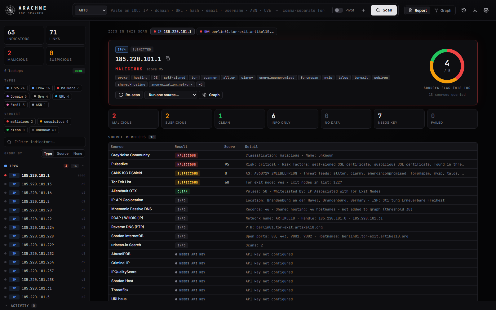

<div align="center">


# ARACHNE

A self-hosted IOC scanner: one indicator in, one report from every threat-intel and OSINT source you've configured. When you want to dig further, it pivots to everything connected to it.

[](https://www.python.org/)
[](LICENSE)



</div>

## About

Give it an IP, domain, URL, email address, username, file hash, ASN or CVE. ARACHNE looks it up across every enabled OSINT and threat-intel source and builds a single scan report: an overall verdict, how many sources flag it, each source's verdict and score, and the full details behind them.

The report also lists the related indicators the sources turned up (hostnames, IPs, emails, hashes, accounts). Scan any of them with one click, or switch on **Pivot** before scanning to look them up automatically, out to whatever depth you set. The **Graph** view maps it all as a web. I built it to stop copy-pasting the same IOC between VirusTotal, AbuseIPDB, Shodan and a dozen other tabs.

It runs locally and only needs Python. There's nothing to install.

## How it works

1. **Scan.** Paste one or more IOCs into the search bar and press **Scan**. The type is detected automatically.
2. **Read the report.** Each enabled source is queried in parallel and the report fills in live: the overall verdict, how many sources flag the IOC, a table with every source's verdict, score and key detail, and the full findings from each one. Sources that need an API key you haven't added are listed separately, so you can see what you're missing.
3. **Pivot (optional).** The report lists every related indicator the sources found. Click **Scan** on any of them, or **Pivot: scan all**, to look them up too, then open the **Graph** view to see how everything connects. To pivot automatically, switch on **Pivot** next to the search bar before scanning and pick a depth.

## Getting started

```bash
git clone https://github.com/luke-mckeever/ARACHNE.git
cd ARACHNE
python server.py
```

The UI opens at `http://127.0.0.1:8777`. On Windows you can double-click `start.bat` instead, and on Linux/macOS run `./start.sh`.

Optional flags: `--port 9000` and `--no-browser`.

### API keys

Add your API keys under **Settings → API Keys**. A lot of sources work without one, but VirusTotal, AbuseIPDB and abuse.ch (MalwareBazaar, URLhaus and ThreatFox) are where most of the useful verdicts come from. Keys are saved to `data/settings.json`, which is git-ignored.

So you don't have to paste them in again on a new machine or after a fresh clone, use **Export keys** to save them to `arachne-api-keys.json` and **Import keys** to load them back. Import only adds or updates keys; it never removes any. The export is plain text, so store it somewhere safe outside the repo folder (exported key files are git-ignored as a backstop).

## Screenshots

| | |
|---|---|
|  **Graph view:** the pivot web |  **Graph view:** per-node intel |
|  **Graph view:** relations |  **Username scan** |
|  **Settings:** modules | |

## Features

- **IOC scan report:** overall verdict, a detection ring (how many sources flag the IOC), a verdict table with one row per source, and detailed findings. Results stream in live as each lookup finishes.
- **Multiple IOCs:** paste several, comma- or newline-separated, and switch between their reports.
- **Pivoting when you want it:** scan related indicators one at a time or all at once from the report, or turn on auto-pivot with configurable depth and node limits. A noise filter stops it crawling through CDNs and big providers.
- **Graph view:** everything found, mapped as a web, with malicious and suspicious nodes highlighted. Large sets of one type (e.g. 40 domains on one IP) collapse into a single box.
- **API key import/export:** back up your keys to a file and load them back in one click.
- **Settings for nearly everything:** turn modules on or off, set rate limits, add custom username sites and lookup links, change colours, set a proxy, and more.
- **Exports:** HTML scan report, per-source verdicts CSV, JSON, a plain IOC list or a PNG of the graph.
- **Saved scans:** every scan is saved, so you can reopen it later and keep pivoting.

## Sources

**No key needed:** DNS, RDAP/WHOIS, crt.sh, HackerTarget, Wayback Machine, Mnemonic passive DNS, Shodan InternetDB, ip-api, SANS ISC, GreyNoise Community, Tor exit list, AlienVault OTX, urlscan.io, OpenPhish, CIRCL hashlookup, RIPEstat, NVD/CISA KEV, Gravatar, GitHub, Keybase, Hacker News, LeakCheck, and a username check across ~40 sites.

**API key:** VirusTotal, AbuseIPDB, MalwareBazaar / URLhaus / ThreatFox (one abuse.ch key), Shodan, IPQualityScore, Criminal IP, SecurityTrails, Hunter.io, Have I Been Pwned, EmailRep, Google Safe Browsing, Hybrid Analysis.

Every module has a **Test** button in Settings, so you can check a key works before running a scan.

## Usage tips

- Click a row in the source verdict table to jump to that source's findings, or ↻ to re-run it.
- Click any indicator in the left list to open its report. Press **V** to switch between the report and the graph.
- In the graph, double-click a node to pivot on it. Right-click for more options, such as running a single module or opening the value in VirusTotal or Shodan. Click a group box to collapse or expand it.
- Use **Clear all** in the graph toolbar to start fresh. The old scan stays in History.
- With auto-pivot, depth 1 is usually enough. Depth 2+ on a busy IP will hit the node limit quickly.
- The free VirusTotal tier is 4 requests/min, so VT results come in slowly. That's expected.

## Adding a module

Modules live in `osint/modules/`. A minimal one looks like this:

```python
@module("myfeed", "My Feed", types=["ipv4", "domain"], keys=["myfeed"], key_required=True,
        category="Threat Intel", desc="Checks my private feed.")
def myfeed(e, ctx, r):
    d = ctx.get_json(f"https://feed.example/api/{e.value}", headers={"X-Key": ctx.need("myfeed")})
    r.kv("Score", d["score"])
    r.score_verdict(d["score"], mal=80, sus=40)
    for host in d.get("related", []):
        r.add("domain", host, "related_to")   # listed as a related indicator in the report
```

It shows up in the UI automatically. To make its key editable in Settings, add the key to `API_KEYS` in `osint/settings.py`.

## Notes

- Everything is passive by default. The one module that connects to the target directly (HTTP Probe) only runs if you enable active modules in Settings.
- The server binds to localhost and has no authentication, so don't expose it publicly.
- Only use this for lawful purposes, and stick to each provider's terms of service.

## License

MIT. `osint/cacert.pem` is Mozilla's CA bundle (MPL-2.0).
