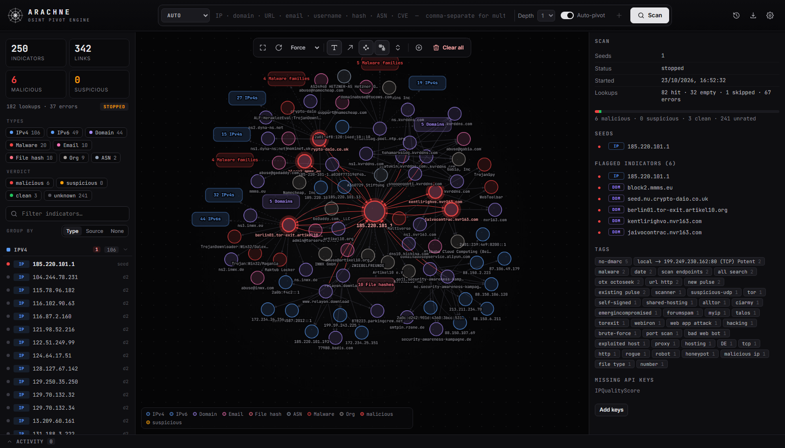
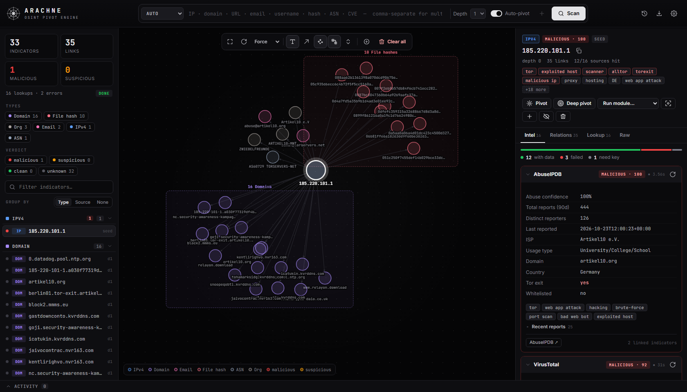
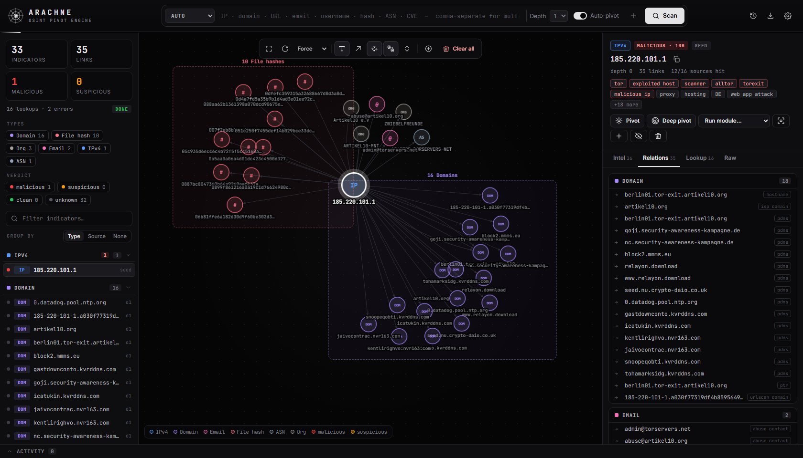
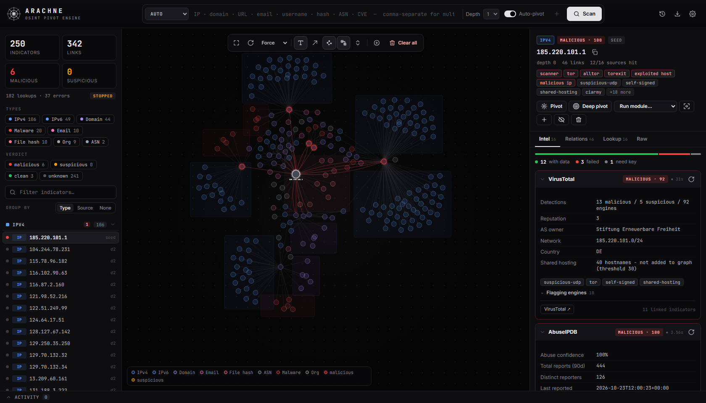
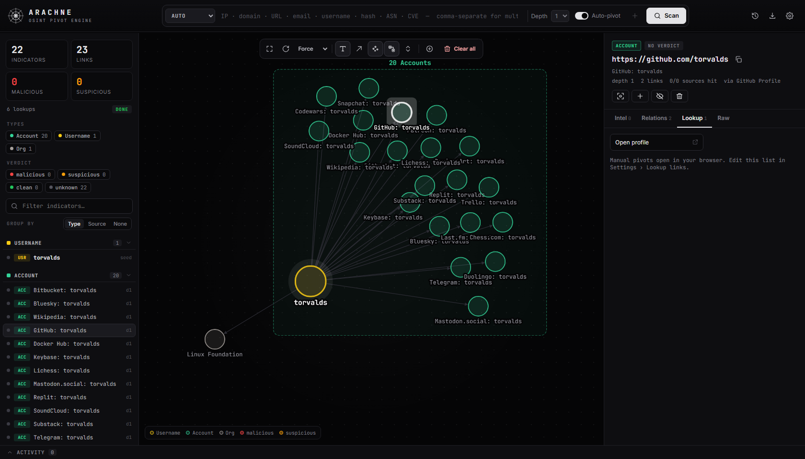
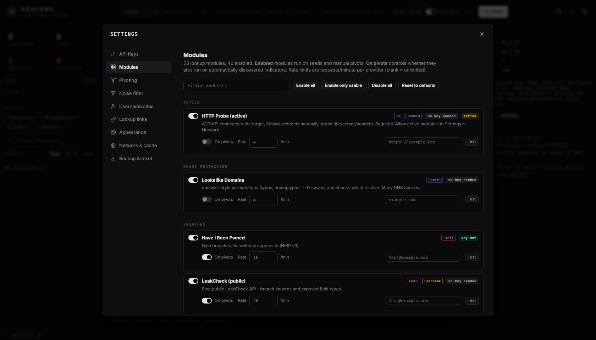
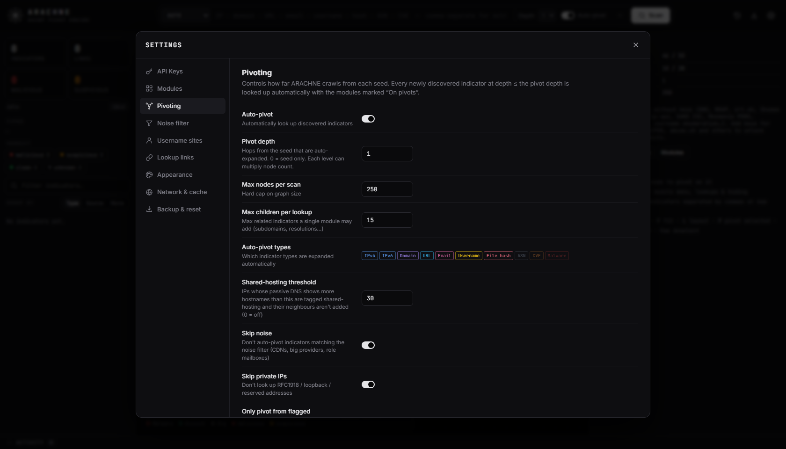
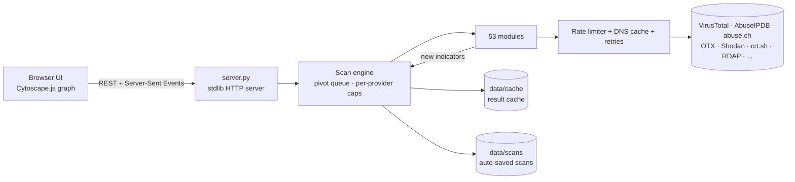

<div align="center">


# ARACHNE

### The OSINT pivot engine: drop in one indicator and watch the web spin itself.

[](https://www.python.org/)
[](#-quick-start)
[](#-intelligence-sources)
[](LICENSE)

**IP · Domain · URL · Email · Username · File hash · ASN · CVE**

[Quick start](#-quick-start) · [Features](#-features) · [Screenshots](#-screenshots) · [Sources](#-intelligence-sources) · [Usage](#-using-arachne) · [Customisation](#%EF%B8%8F-customisation) · [Extending](#-writing-your-own-module)

<br>



</div>

---

## 🕸️ What is it?

ARACHNE is a **self-hosted OSINT and threat-intelligence scanner** built around one idea: **pivoting**.

Give it an indicator of compromise (IOC) or a username. It queries every enabled source, from VirusTotal, AbuseIPDB, MalwareBazaar, Shodan and OTX to DNS, WHOIS, certificate transparency and username enumeration. It then draws everything it learns as an **interactive spiderweb**.

Then it keeps going. Every new IP, domain, email, hash or account it discovers is **automatically looked up as well**, out to the depth you choose. A single Tor-exit IP becomes its hostnames, hosting company, ASN, abuse contacts, sibling exit nodes, malware samples that talk to it, and the domains those samples call home to.

It runs locally in your browser, needs **nothing but Python**, and every behaviour is configurable from the UI.

---

## ✨ Features

<table>
<tr>
<td width="50%" valign="top">

### 🔁 Automatic pivoting
- Breadth-first crawl with a configurable **depth**, **node cap** and **children-per-lookup** limit
- **Deep pivot** any node to keep crawling from there
- A **noise filter** stops expansion through CDNs, big providers and role mailboxes (`info@`, `abuse@`…)
- **Shared-hosting detection** stops one busy IP from flooding the graph
- An "Only pivot from flagged indicators" mode for tight threat hunts

</td>
<td width="50%" valign="top">

### 🕸️ Live spiderweb graph
- Results **stream in live**, and nodes pulse while their lookups run
- Verdict glow: 🔴 malicious · 🟠 suspicious
- **Neighbour grouping**: siblings of one type collapse into boxes like `16 Domains`
- Force, rings-by-depth, tree, organic, circle and grid layouts
- Hover to trace connections. Right-click for everything else.

</td>
</tr>
<tr>
<td valign="top">

### 🧠 53 intelligence modules
- Threat intel, network, DNS, registration, subdomains, malware, breaches, people and vulnerabilities
- **32 work with no API key at all**
- A per-provider **rate limiter** (VirusTotal's free-tier 4/min is respected automatically)
- Results are **cached** to save your API quota

</td>
<td valign="top">

### 🎛️ Extremely customisable
- Add **API keys** in the UI, with a live **Test** button for every module
- Toggle modules, set per-module rate limits and choose what runs on pivots
- Add your own **username sites** and **lookup links**
- Accent colour, per-type colours, monochrome mode, node and label size
- Proxy (e.g. Burp), User-Agent, DoH resolver and timeouts

</td>
</tr>
<tr>
<td valign="top">

### 📑 Reporting and history
- Export an **HTML report**, JSON, CSV, a plain IOC list or a PNG of the graph
- Scans **auto-save**: reopen any scan from History and keep pivoting
- **Deep links** to a scan, a node or a settings tab

</td>
<td valign="top">

### 🔒 Passive and private by default
- Only the HTTP Probe module touches the target directly, and it's **off** until you allow active modules
- API keys stay in `data/settings.json` on your machine (git-ignored)
- The server binds to `127.0.0.1` and refuses cross-origin requests

</td>
</tr>
</table>

---

## 🚀 Quick start

> **Requirements:** Python **3.10+**. That's it: no `pip install`, no Node, no Docker.

```bash
git clone https://github.com/luke-mckeever/ARACHNE.git
cd ARACHNE
python server.py
```

Your browser opens at **http://127.0.0.1:8777**.

| Platform | One-click launcher |
|---|---|
| Windows | double-click **`start.bat`** |
| Linux / macOS | `chmod +x start.sh && ./start.sh` |

```text
python server.py --port 9000        # different port
python server.py --no-browser       # don't auto-open the browser
python server.py --host 0.0.0.0     # expose on your LAN (careful: no auth!)
```

> [!NOTE]
> The graph library (Cytoscape.js) and the fonts load from a CDN, so the machine running your browser needs internet access. The lookups need it anyway.

---

## 📸 Screenshots

<table>
<tr>
<td width="50%"><p align="center"><b>Per-source intel</b>: verdicts, key facts, tables and links, with failures grouped neatly below</p></td>
<td width="50%"><p align="center"><b>Relations by type</b>: every neighbour, how it's linked, and which source found it</p></td>
</tr>
<tr>
<td><p align="center"><b>Depth-1 pivot</b>: 250 indicators with neighbour groups expanded</p></td>
<td><p align="center"><b>Persona pivot</b>: a username enumerated across ~40 sites and profile APIs</p></td>
</tr>
<tr>
<td><p align="center"><b>Module control</b>: enable, rate-limit, pivot-toggle and live-test every source</p></td>
<td><p align="center"><b>Pivot tuning</b>: depth, caps, types, noise and shared-hosting rules</p></td>
</tr>
</table>

---

## 🔎 Intelligence sources

🆓 = works without a key · 🔑 = API key required · 🔓 = key optional (raises limits)

| Category | Modules |
|---|---|
| **Threat intel** | 🔑 VirusTotal · 🔑 AbuseIPDB · 🔓 AlienVault OTX · 🔑 ThreatFox · 🔑 URLhaus · 🔓 GreyNoise · 🆓 SANS ISC DShield · 🆓 Tor exit list · 🔓 Pulsedive · 🔓 urlscan.io · 🆓 OpenPhish · 🔑 Google Safe Browsing · 🔑 IPQualityScore · 🔑 Criminal IP |
| **Malware** | 🔑 MalwareBazaar (sample + family) · 🔑 ThreatFox (hash + family IOCs) · 🔑 URLhaus payloads · 🔑 Hybrid Analysis · 🆓 CIRCL hashlookup (known-good files) |
| **Network & geo** | 🆓 ip-api · 🔓 ipinfo · 🆓 Shodan InternetDB · 🔑 Shodan Host · 🆓 RDAP/WHOIS (IP) · 🆓 RIPEstat ASN |
| **DNS** | 🆓 DNS records over DoH (A/AAAA/MX/NS/TXT/SOA/CAA + SPF/DMARC parsing) · 🆓 Reverse DNS · 🆓 Mnemonic passive DNS · 🆓 Parent-domain linking |
| **Registration & history** | 🆓 RDAP/WHOIS (domain, flags newly registered domains) · 🆓 Wayback Machine |
| **Subdomains** | 🆓 crt.sh certificate transparency · 🆓 HackerTarget · 🔑 SecurityTrails |
| **People & email** | 🆓 Username enumeration (~40 sites, editable) · 🔓 GitHub profile + commit emails · 🔓 GitHub email search · 🔓 Gravatar · 🆓 Keybase proofs · 🆓 Hacker News · 🔑 Hunter.io (domain search + verifier) · 🔑 EmailRep · 🆓 Email breakdown (disposable / webmail detection) |
| **Breaches** | 🔑 Have I Been Pwned · 🆓 LeakCheck public |
| **Vulnerabilities** | 🔓 NVD + CISA Known Exploited Vulnerabilities |
| **Brand protection** | 🆓 Lookalike-domain generator (typos, homoglyphs, TLD swaps) |
| **Active** *(off by default)* | HTTP probe: redirect chain, title, server, password forms |

### Getting API keys

All of these have free tiers. Open **Settings → API Keys**: every key has a *Get a key ↗* link, and the page warns you if the same key has been pasted into two fields.

| Key | Unlocks | Free tier |
|---|---|---|
| [VirusTotal](https://www.virustotal.com/gui/my-apikey) | Multi-AV verdicts, passive DNS, related files | 4 req/min, 500/day |
| [AbuseIPDB](https://www.abuseipdb.com/account/api) | IP abuse confidence and reports | 1,000/day |
| [abuse.ch Auth-Key](https://auth.abuse.ch/) | **MalwareBazaar, URLhaus and ThreatFox** (one key) | generous |
| [AlienVault OTX](https://otx.alienvault.com/api) | Faster and higher OTX limits | free |
| [Shodan](https://account.shodan.io/) | Full host records | limited |
| [GreyNoise](https://viz.greynoise.io/account/api-key) | Community API | free |
| [urlscan.io](https://urlscan.io/user/profile/) | Higher search quota | free |
| [Hybrid Analysis](https://www.hybrid-analysis.com/my-account?tab=%23api-key-tab) | Sandbox verdicts | free |
| [Have I Been Pwned](https://haveibeenpwned.com/API/Key) | Breach lookups | paid |
| [GitHub token](https://github.com/settings/tokens) | 60 → 5,000 req/hr (no scopes needed) | free |

---

## 🧭 Using ARACHNE

### Your first scan

1. Paste an indicator into the search bar: `185.220.101.1`, `example.com`, `someone@example.com`, `torvalds`, a SHA-256, `AS13335` or `CVE-2021-44228`. **Defanged** input (`hxxp://evil[.]com`) works, and several seeds can be **comma- or newline-separated**.
2. Pick a **depth** (`1` is a good start) and press **Scan**.
3. Watch the web grow. Click any node to see what each source said about it.

### Graph controls

| Action | How |
|---|---|
| Inspect a node | **Click** it. The right panel has Intel, Relations, Lookup and Raw tabs. |
| Pivot on a node | **Double-click**, or right-click → *Pivot* |
| Keep crawling from a node | Right-click → *Deep pivot* |
| Run one specific module | Right-click → *Run module*, or the dropdown in the panel |
| Collapse / expand a group | **Click** the group box, or use the ⇕ toolbar button for all groups |
| Act on a whole group | Right-click the box → pivot all, copy values, hide, remove |
| Manual lookups | Lookup tab, or right-click → *Open in…* (VirusTotal, Shodan, Censys, Talos…) |
| Add an indicator | ⊕ in the toolbar, or right-click → *Add linked indicator* |
| Start fresh | 🗑 **Clear all** in the toolbar (the scan stays in History) |
| Filter | Type and verdict chips on the left (Shift+click solos a type), plus the search box |

**Keyboard:** `/` search · `F` fit · `L` re-layout · `P` pivot selected · `Del`/`H` hide · `Esc` deselect

### Exports

**HTML report** (graph image, flagged indicators and every finding) · **JSON** (full scan) · **CSV** (one row per indicator) · **IOC list** (grouped plain text) · **PNG** (high-res graph)

### Deep links

```text
http://127.0.0.1:8777/#scan=<id>                         open a saved scan
http://127.0.0.1:8777/#scan=<id>&node=ipv4:1.2.3.4       ...and select a node
http://127.0.0.1:8777/#scan=<id>&groups=collapsed        ...with neighbour groups collapsed
http://127.0.0.1:8777/#settings=modules                  jump straight to a settings tab
```

---

## 🎛️ Customisation

Everything lives in the **Settings** menu (⚙):

| Tab | What you can change |
|---|---|
| **API Keys** | Add, replace or clear keys, with duplicate-key detection |
| **Modules** | Enable/disable, *run on pivots*, rate limit per minute, module options, **live Test** with any value |
| **Pivoting** | Auto-pivot, depth, max nodes, max children, which types pivot, shared-hosting threshold, skip noise/private, only pivot from flagged |
| **Noise filter** | Domains (with subdomains), keywords, IPs/CIDRs and `user:` names that are shown but never expanded |
| **Username sites** | Toggle the built-ins or add your own (URL template + HTTP-status or text-match rule) |
| **Lookup links** | Your manual-pivot bookmarks per type, using `{value}`, `{enc}` and `{b64}` placeholders |
| **Appearance** | Accent colour, colour per type, monochrome, node/label size, labels, edge labels, layout, animation, grid, **neighbour grouping**, list grouping |
| **Network & cache** | Timeout, concurrency, per-provider parallelism, HTTP proxy, User-Agent, DoH resolver, TLS verification, active modules, cache TTL |
| **Backup & reset** | Export/import settings (with or without keys), reset any section |

---

## 🏗️ How it works



1. The **engine** schedules every enabled module for each seed.
2. Each **module** returns facts, a verdict and *new indicators* (`r.add("domain", …, "resolves_to")`).
3. New indicators become nodes. If they pass the pivot rules (depth, type, noise, node cap), they're queued for lookup themselves.
4. Every step is streamed to the browser over **Server-Sent Events**, so the web grows in real time.

```text
arachne-osint/
├── server.py              # HTTP API + live event stream + static files
├── start.bat / start.sh   # launchers
├── osint/
│   ├── engine.py          # scan graph, pivot logic, scheduling, persistence
│   ├── registry.py        # @module decorator, Result object, request context
│   ├── entities.py        # IOC detection, refanging, normalisation
│   ├── util.py            # HTTP client, rate limiter, DNS cache, disk cache
│   ├── settings.py        # defaults + API key catalogue
│   ├── sites.py           # username enumeration site list
│   ├── cacert.pem         # Mozilla CA bundle (reliable TLS on Windows)
│   └── modules/           # ip, domain, url, email, username, filehash, threatintel, misc
├── static/                # index.html, css/app.css, js/{config,app,settings}.js
└── data/                  # created at runtime - keys, cache, scans (git-ignored)
```

---

## 🧩 Writing your own module

Drop a function into any file in `osint/modules/`. It appears in the UI automatically, with its own toggle, rate limit and Test button.

```python
from ..registry import NotFound, module

@module("myfeed", "My Threat Feed", types=["ipv4", "domain"], keys=["myfeed"], key_required=True,
        rate=30, category="Threat Intel", sample="8.8.8.8",
        desc="Looks the indicator up in my private feed.")
def myfeed(e, ctx, r):
    d = ctx.get_json(f"https://feed.example/api/{e.value}", headers={"X-Key": ctx.need("myfeed")})
    if not d.get("hits"):
        raise NotFound("Not listed")
    r.kv("Hits", d["hits"])                      # key/value facts
    r.score_verdict(d["score"], mal=80, sus=40)  # malicious / suspicious / clean
    r.tag("botnet")
    for host in d.get("related", []):
        r.add("domain", host, "related_to")      # becomes a new node, and gets pivoted
    r.table("Sightings", ["Date", "Source"], [[s["date"], s["src"]] for s in d["sightings"]])
    r.link("My Feed", f"https://feed.example/ui/{e.value}")
```

To make the key configurable in the UI, add an entry for it to `API_KEYS` in `osint/settings.py`.

---

## 🩺 Troubleshooting

| Symptom | Fix |
|---|---|
| `unknown_auth_key` from URLhaus / ThreatFox / MalwareBazaar | The abuse.ch key is wrong. It's **not** your AbuseIPDB key. Get one at [auth.abuse.ch](https://auth.abuse.ch/). |
| `HTTP 429` / *rate limited* | You've hit the provider's quota. Lower that module's rate limit, or add a key where one is optional. |
| *TLS certificate could not be verified* | Corporate SSL inspection or a proxy like Burp. Turn off **Settings → Network → Verify TLS** only if you trust it. |
| *hostname could not be resolved* | DNS or network trouble. Lookups retry automatically, so check your connection or VPN. |
| VirusTotal feels slow | The free tier is 4 requests/minute and the limiter honours it. With a premium key, raise the rate in **Modules**. |
| The graph is a hairball | Lower the depth, enable **Group neighbours**, collapse groups (⇕), hide noise, or lower the shared-hosting threshold. |

---

## ⚖️ Responsible use

ARACHNE queries **public and third-party sources**. Use it only for **lawful** purposes such as threat intelligence, incident response, security research and authorised investigations. Respect each provider's terms of service and rate limits, and the privacy of the people behind usernames and email addresses. The authors accept no liability for misuse.

## 📄 License

[MIT](LICENSE). The bundled `osint/cacert.pem` is Mozilla's CA bundle (MPL-2.0).

<div align="center">
<br>
<sub>Built for analysts who'd rather follow the thread than copy-paste between twenty browser tabs. 🕷️</sub>
</div>
