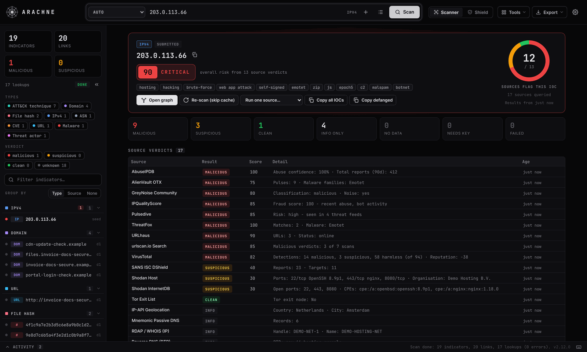
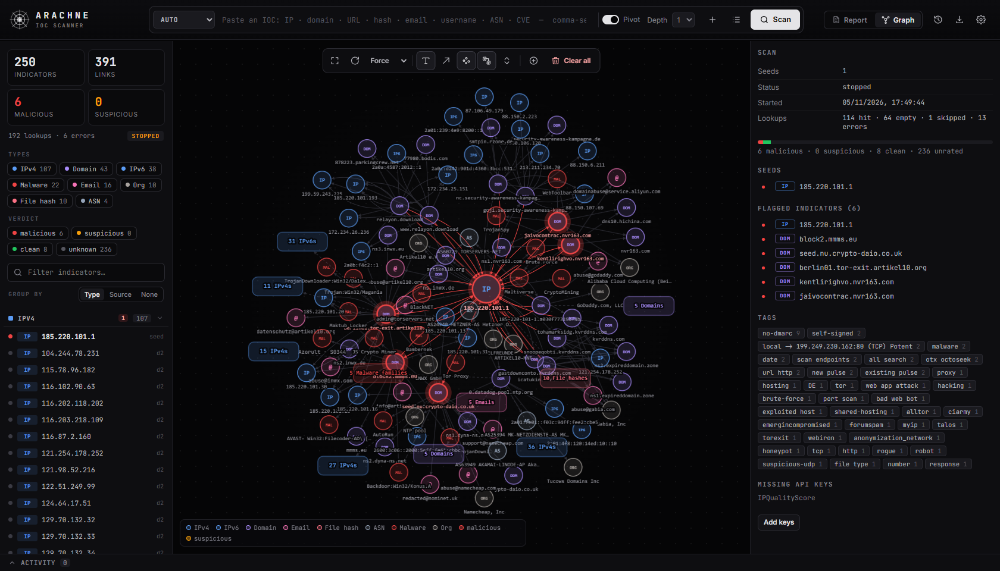
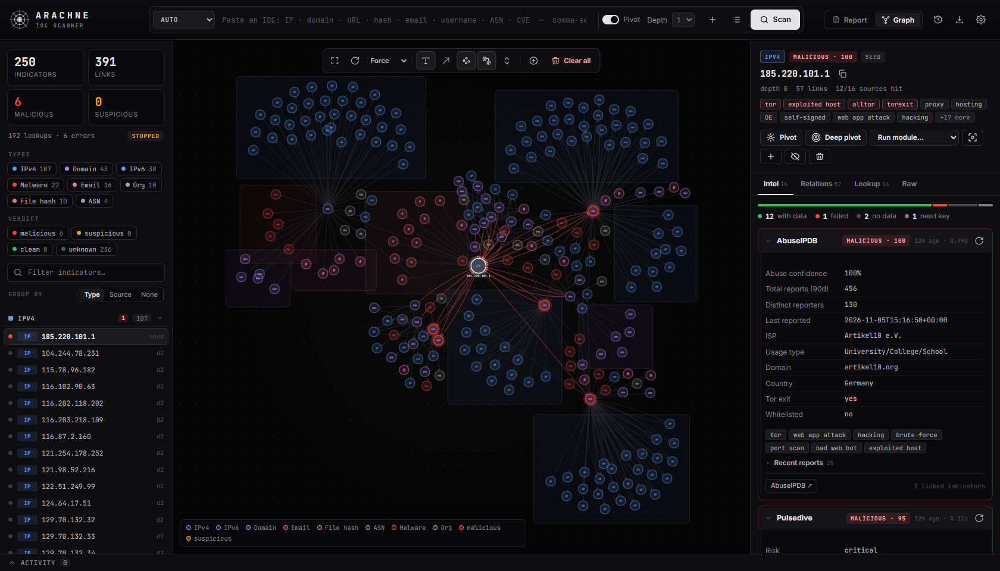
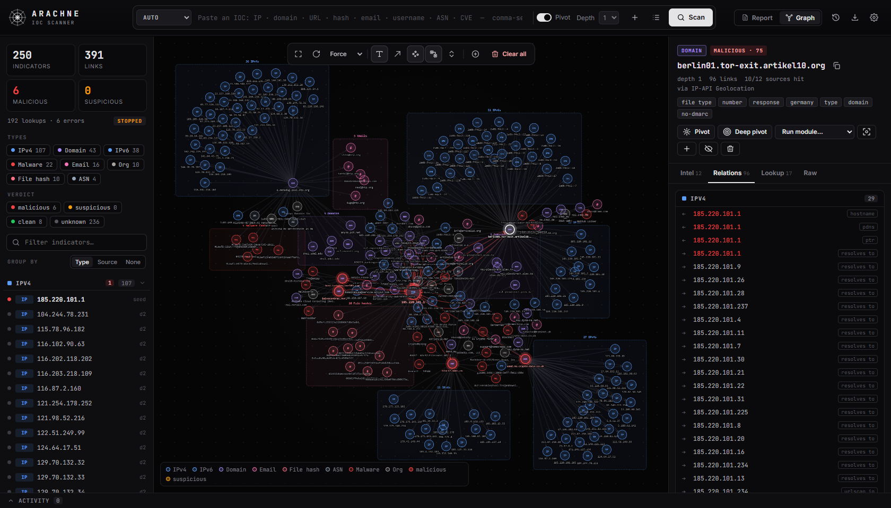
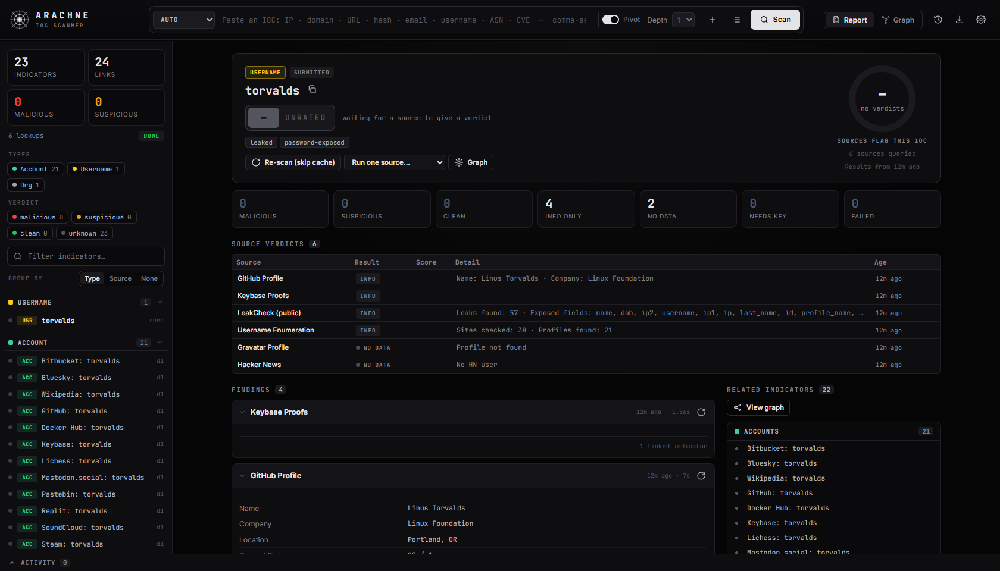
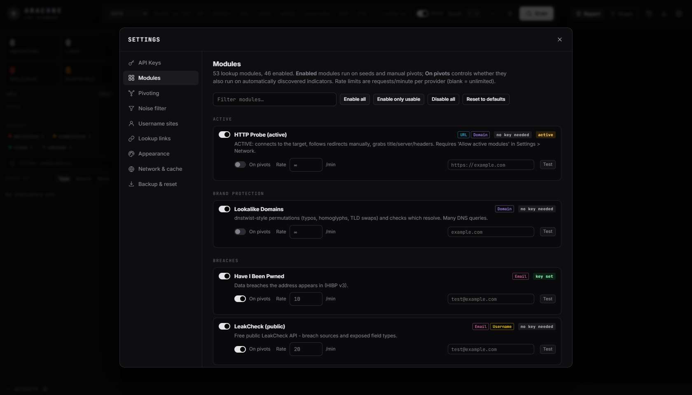
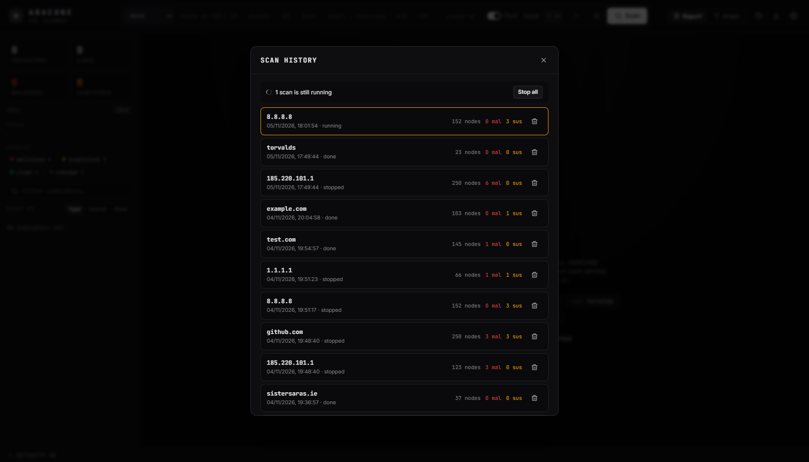

<div align="center">


# ARACHNE

Self-hosted threat intelligence and OSINT: one indicator in, one report from every threat-intel and OSINT source you've configured. When you want to dig further, it pivots to everything connected to it.

[](https://www.python.org/)
[](LICENSE)



</div>

## About

Give it an IP, domain, URL, email address, username, file hash, ASN or CVE. ARACHNE looks it up across every enabled OSINT and threat-intel source and builds a single scan report: an overall verdict, how many sources flag it, each source's verdict and score, and the full details behind them.

The report also lists the related indicators the sources turned up (hostnames, IPs, emails, hashes, accounts). Scan any of them with one click, or switch on **Pivot** before scanning to look them up automatically, out to whatever depth you set. The **Graph** view maps it all as a web. I built it to stop copy-pasting the same IOC between VirusTotal, AbuseIPDB, Shodan and a dozen other tabs.

It runs locally and only needs Python. There's nothing to install.

## How it works

1. **Scan.** Paste one or more IOCs into the search bar and press **Scan**. The type is detected automatically. For a longer list, use the **bulk scan** button next to it to paste or upload a file.
2. **Read the report.** Each enabled source is queried in parallel and the report fills in live: the overall verdict, how many sources flag the IOC, a table with every source's verdict, score and key detail, and the full findings from each one. Sources that need an API key you haven't added are listed separately, so you can see what you're missing.
3. **Pivot (optional).** The report lists every related indicator the sources found. Click **Scan** on any of them, or **Pivot: scan all**, to look them up too, then open the **Graph** view to see how everything connects. To pivot automatically, switch on **Pivot** next to the search bar before scanning and pick a depth.

## Getting started

```bash
git clone https://github.com/luke-mckeever/ARACHNE.git
cd ARACHNE
python server.py
```

The UI opens at `http://127.0.0.1:8777`. On Windows you can double-click `start.bat` instead, and on Linux/macOS run `./start.sh`.

To shut it down, press Ctrl+C in its window, or double-click `stop.bat` (Windows) / run `./stop.sh` (Linux/macOS). The stop script finds the server through `data/arachne.pid`; if you started it on another port, pass the port: `stop.bat 9000` or `./stop.sh 9000`.

Optional flags: `--port 9000` and `--no-browser`.

### API keys

Add your API keys under **Settings → API Keys**. A lot of sources work without one, but VirusTotal, AbuseIPDB and abuse.ch (MalwareBazaar, URLhaus and ThreatFox) are where most of the useful verdicts come from. Keys are saved to `data/settings.json`, which is git-ignored.

So you don't have to paste them in again on a new machine or after a fresh clone, use **Export keys** to save them to `arachne-api-keys.json` and **Import keys** to load them back. Import only adds or updates keys; it never removes any. The export is plain text, so store it somewhere safe outside the repo folder (exported key files are git-ignored as a backstop).

## Screenshots

| | |
|---|---|
|  **Graph view:** the pivot web |  **Graph view:** per-node intel |
|  **Graph view:** relations |  **Username scan** |
|  **Settings:** modules |  **History:** running scans and Stop all |

## Features

- **IOC scan report:** a headline risk score and grade, a detection ring (how many sources flag the IOC), a verdict table with one row per source, and detailed findings. Results stream in live as each lookup finishes.
- **Overall risk score:** every IOC gets a 0–100 score and a grade (Critical, High, Medium, Low, Clean) combined from the per-source verdicts. Any malicious verdict sets a floor of 50 (suspicious: 25), and the share of sources that flag the IOC fills the rest.
- **Extract IOCs from text:** paste a phishing email (headers too), a threat report, logs or a web page, or load the file, and ARACHNE pulls out every IP, domain, URL, email, file hash, CVE and ASN in it, defanged ones included. Duplicates are merged, private IPs, well-known sites (Google, Microsoft, w3.org…) and anything on your own "always leave out" list start unticked, and you scan the rest in one bulk scan. Press **X**, or use the **Extract from text** tab of the bulk scan dialog.
- **Bulk scanning:** paste, upload or drop a list of up to 500 IOCs (defanged values are fine). You get a combined triage report sorted by risk, with a filter, a "medium and above" toggle and one-click copy of the flagged IOCs.
- **Freshness:** every source result shows how old it is and whether it came from the cache. **Re-scan (skip cache)** runs every source again, for one IOC or a whole bulk scan.
- **Pivoting when you want it:** scan related indicators one at a time or all at once from the report, or turn on auto-pivot with configurable depth and node limits. A noise filter stops it crawling through CDNs and big providers.
- **Graph view:** everything found, mapped as a web, with malicious and suspicious nodes highlighted. Large sets of one type (e.g. 40 domains on one IP) collapse into a single box.
- **API key import/export:** back up your keys to a file and load them back in one click.
- **Settings for nearly everything:** turn modules on or off, set rate limits, add custom username sites and lookup links, change colours, set a proxy, and more.
- **Exports:** scan report as PDF (via the browser's Save as PDF) or HTML, a STIX 2.1 bundle (an indicator per IOC with the risk score as confidence, plus linked malware families) for TIPs and SIEMs, per-source verdicts CSV, JSON, a plain IOC list or a PNG of the graph.
- **Detection rules:** Export > Detection rules turns a scan's indicators into Sigma, YARA, Suricata and Snort rules, and Splunk (SPL), Microsoft Sentinel (KQL) and Elastic (KQL) queries, to copy or download. Values are checked and escaped for each rule language; titles and messages show them defanged. Run `node tests/rules.test.mjs` to test the generator.
- **Arachne Shield (threat actors and MITRE ATT&CK):** the **Shield** tab, next to Report and Graph (or press **I**), is a page for attribution. **Attribution** lists every IOC in the scan with the threat actors the sources tie it to and a confidence (High, Medium, Low or Not attributed): only what the sources said about the IOC itself counts, and malware many actors share (Cobalt Strike, Mimikatz, remote access tools) attributes nothing on its own. **ATT&CK** maps the scan onto the ATT&CK matrix (copy the technique IDs or download an ATT&CK Navigator layer), **Timeline** puts every date the sources reported in order (first seen, registered, campaign activity), and **Library** has profile pages for ~1,100 threat actors, ~840 malware families and tools, ATT&CK campaigns and techniques. A "How Shield works" summary sits at the bottom of the page. The report shows the same evidence for one IOC as **Threat context**. You can also scan an actor, family or ATT&CK ID (`T1059.001`, `G0016`, `S0154`, `C0022`) directly. Works offline: the data ships with ARACHNE (see [Threat intel data](#threat-intel-data)).
- **Saved scans:** every scan is saved, so you can reopen it later and keep pivoting.
- **Languages:** the interface comes in English, Spanish, German, French, Portuguese, Italian, Dutch, Polish, Japanese, Chinese and Korean. It follows your browser's language; change it under **Settings → Appearance → Interface language**.
- **Stop all scans:** scans keep running even if no tab is showing them. **History** highlights any that are still running and has a **Stop all** button, and the same switch lives under **Settings → Network & cache**.

## Sources

**No key needed:** MITRE ATT&CK & threat actors (built in, offline), DNS, RDAP/WHOIS, crt.sh, Wayback Machine, Mnemonic passive DNS, Shodan InternetDB, ip-api, SANS ISC, GreyNoise Community, Tor exit list, AlienVault OTX, urlscan.io, OpenPhish, CIRCL hashlookup, RIPEstat, NVD/CISA KEV, Gravatar, GitHub, Keybase, Hacker News, LeakCheck, and a username check across ~40 sites.

**API key:** VirusTotal, AbuseIPDB, MalwareBazaar / URLhaus / ThreatFox (one abuse.ch key), Shodan, IPQualityScore, SecurityTrails, Hunter.io, Have I Been Pwned, EmailRep, Google Safe Browsing, Hybrid Analysis.

Every module has a **Test** button in Settings, so you can check a key works before running a scan.

## Usage tips

- Click a row in the source verdict table to jump to that source's findings, or ↻ to re-run it.
- Click any indicator in the left list to open its report. Press **V** to switch between the report and the graph.
- In the graph, double-click a node to pivot on it. Right-click for more options, such as running a single module or opening the value in VirusTotal or Shodan. Click a group box to collapse or expand it.
- Use **Clear all** in the graph toolbar to start fresh. The old scan stays in History.
- With auto-pivot, depth 1 is usually enough. Depth 2+ on a busy IP will hit the node limit quickly.
- The free VirusTotal tier is 4 requests/min, so VT results come in slowly. That's expected.
- If the app feels sluggish, check **History** for scans still running in the background (big auto-pivots can take a while) and use **Stop all**.
- archive.org's URL index is often slow or overloaded. When it doesn't answer, the Wayback Machine module still shows the first and last capture and says why the full URL list is missing.
- Hunter.io's free plan returns 10 emails per domain; the module adapts to your plan's limit and shows e.g. "10 of 4218".
- ThreatFox only flags exact matches: a URL on the same host, or the same IP on any port. Domains that merely contain the IOC (e.g. `gillzmentortest.com` for `test.com`) are ignored.

## Adding a module

Modules live in `osint/modules/`. A minimal one looks like this:

```python
@module("myfeed", "My Feed", types=["ipv4", "domain"], keys=["myfeed"], key_required=True,
        category="Threat Intel", desc="Checks my private feed.")
def myfeed(e, ctx, r):
    d = ctx.get_json(f"https://feed.example/api/{e.value}", headers={"X-Key": ctx.need("myfeed")})
    r.kv("Score", d["score"])
    r.score_verdict(d["score"], mal=80, sus=40)
    for host in d.get("related", []):
        r.add("domain", host, "related_to")   # listed as a related indicator in the report
```

It shows up in the UI automatically. To make its key editable in Settings, add the key to `API_KEYS` in `osint/settings.py`.

## Threat intel data

`static/intel/threat-kb.json` holds the threat actor, malware and ATT&CK data. It is built from open sources that allow commercial use, by `python tools/build_threat_kb.py` (run it after a new ATT&CK release and commit the result):

- **MITRE ATT&CK Enterprise** (techniques, groups, software, campaigns). © The MITRE Corporation. This work is reproduced and distributed with the permission of The MITRE Corporation, under MITRE's royalty-free [ATT&CK Terms of Use](https://attack.mitre.org/resources/legal-and-branding/terms-of-use/), which allow research, development and commercial use.
- **MISP Galaxy** threat-actor cluster (extra actors, country, suspected sponsor, targets, references) and the names and aliases from its malpedia cluster. CC0 1.0 / BSD 2-Clause.
- **Malpedia** itself (CC BY-NC-SA, non-commercial) and the **ETDA Threat Group Cards** (CC BY-NC-SA 4.0) are not copied, only linked.

## Translations

The interface text is translated in the browser by `static/js/i18n.js`, using one dictionary per language in `static/i18n/<code>.json` (English phrase → translation). Data from sources is never translated. To add or fix a phrase, edit the dictionaries; `{name}` placeholders and `<0>…</0>` tags must stay as they are. To find text that isn't translated yet, run `localStorage.setItem("arachne.i18n.debug","1")` in the browser console, reload, use the app, then run `I18N.missing()`. Run `python tools/check_i18n.py` before committing: it checks that every language has the same phrases and placeholders.

## Notes

- Everything is passive by default. The one module that connects to the target directly (HTTP Probe) only runs if you enable active modules in Settings.
- The server binds to localhost and has no authentication, so don't expose it publicly.
- Only use this for lawful purposes, and stick to each provider's terms of service.

## Versions

ARACHNE uses version numbers like `v2.3.0` (major.minor.patch). The current version is shown at the bottom right of the app, every release is tagged in git, and [CHANGELOG.md](CHANGELOG.md) lists what changed in each one.

## License

MIT. `osint/cacert.pem` is Mozilla's CA bundle (MPL-2.0).
