<div align="center">


# ARACHNE

**Threat intelligence and OSINT investigation platform.** One indicator in, one report from every threat-intel and OSINT source you use, with risk scoring, threat actor attribution and a pivot graph of everything connected to it.

Run it yourself in a minute, or use it online at **[arachne-app.site](https://arachne-app.site)**.

[](https://arachne-app.site)
[](https://www.python.org/)
[](LICENSE)


</div>

## About

Give ARACHNE an IP address, domain, URL, email address, username, file hash, ASN or CVE (defanged values like `hxxps://evil[.]com` are fine). It looks the indicator up across every enabled source at once and builds one scan report: a 0 to 100 risk score, how many sources flag it, each source's verdict and the full details behind them.

From there you can pivot to everything the sources turned up (hostnames, IPs, hashes, malware, threat actors), see it all as a graph, find out which threat actors and ATT&CK techniques the scan points to, and export detection rules for your SIEM. I built it to stop copy-pasting the same IOC between VirusTotal, AbuseIPDB, Shodan and a dozen other tabs.

The app has three parts, shown as tabs at the top:

- **Scanner:** the IOC scan, its report and the pivot graph.
- **Shield:** threat actor attribution, MITRE ATT&CK mapping, defences and a timeline for the scanned IOCs.
- **Sandbox:** in-browser file and email analysis. Website only (see below).

## Use it online: arachne-app.site

<a href="https://arachne-app.site">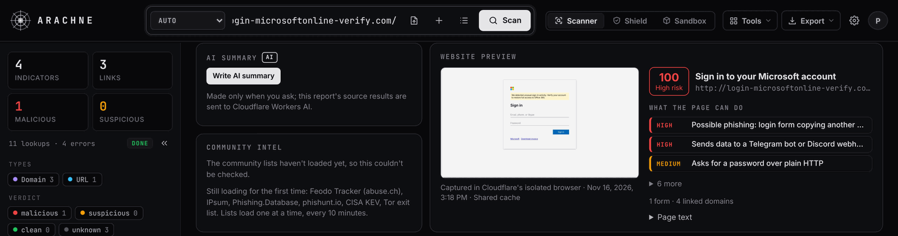</a>

**[arachne-app.site](https://arachne-app.site)** is the hosted version of ARACHNE. It has everything in this repository with nothing to install, plus features that need a server and can't run in a local copy:

| | |
|---|---|
| **Sandbox** | Drop a file (programs, Office documents, PDFs, scripts, archives, Android apps, OneNote, .eml / .msg emails) and get a risk score, detections, static analysis, decoded code, network indicators, YARA matches (bring your own rules too) and **"What can this file do?"**: the open capa rules matched against the program's machine code, with ATT&CK techniques. Everything runs in your browser: the file is never uploaded or run. |
| **Email header analyser** | Paste an email's headers or drop the .eml / .msg: SPF, DKIM, DMARC and ARC results, lookalike domains, the delivery path hop by hop, and one click to scan every sender address and server. |
| **Website preview** | Every URL and domain you scan is opened in Cloudflare's isolated browser, never in yours. You get a screenshot, the redirect chain, form fields and what the page can do (password or card forms, data sent to Telegram or Discord, obfuscated scripts, downloads), with a risk score that feeds the verdict. |
| **ARACHNE Intel DB** | The site's own database of every indicator scanned on it and every open community blocklist (Feodo Tracker, IPsum, Phishing.Database and more): when ARACHNE first and last saw an indicator and each source's latest verdict. Who scanned what is never stored. PRO accounts can run **private scans** that stay out of the shared database. |
| **AI summaries** | A plain-language summary of a scan report, written on request by Cloudflare Workers AI. |
| **Accounts** | Sign in, keep scan history, saved cases and share links, with your API keys kept in your own browser (optionally locked with a password). New accounts are approved by an admin; some features are for PRO accounts (ask at [info@arachne-app.site](mailto:info@arachne-app.site)). |
| **Admin portal** | For the site owner: users and PRO plans, usage and audit log, branding and themes, banners and maintenance, legal pages, and switches and limits for every feature. |

<table>
<tr>
<td width="50%">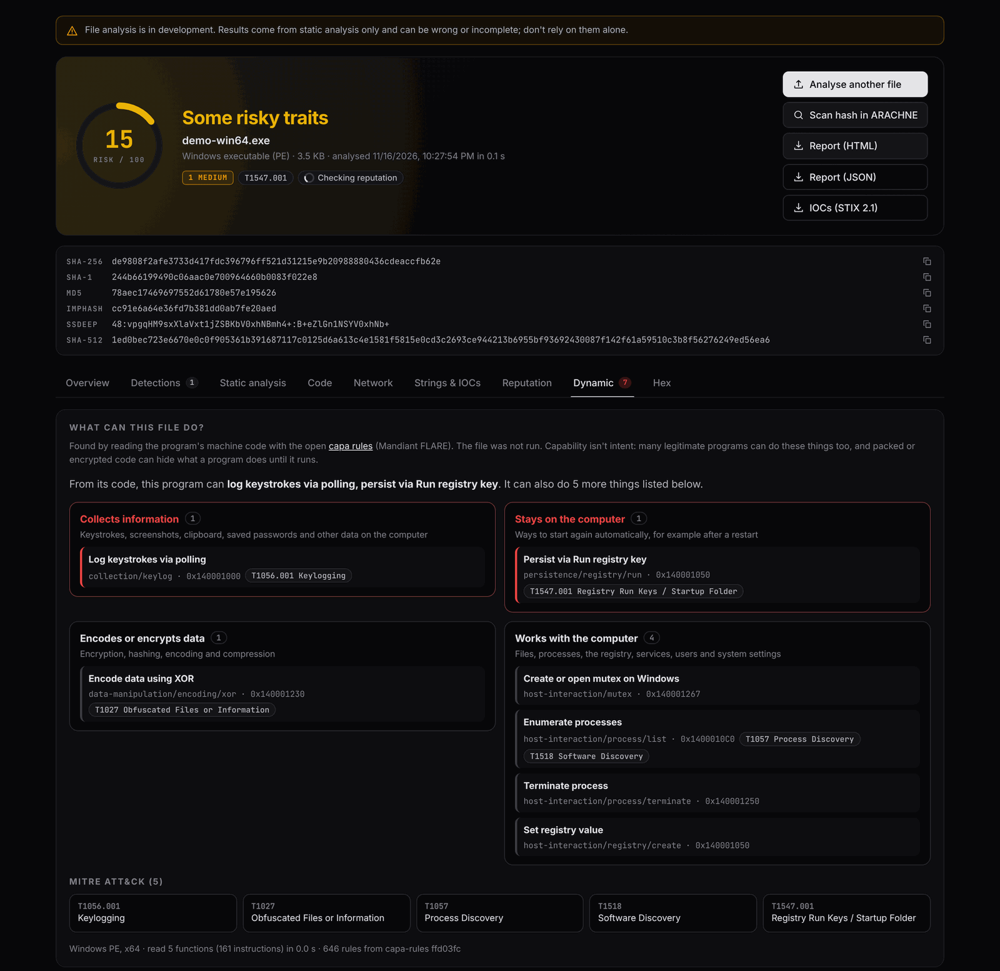<br><b>Sandbox:</b> what a program can do, from its machine code</td>
<td width="50%">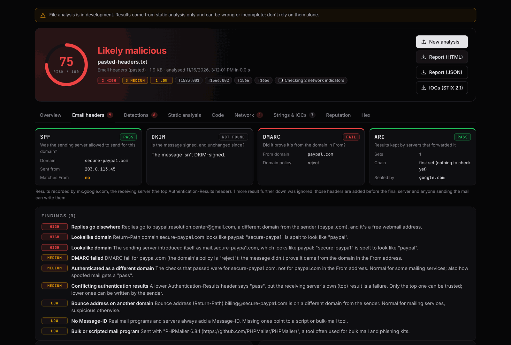<br><b>Email header analyser:</b> authentication results and lookalike domains</td>
</tr>
<tr>
<td colspan="2">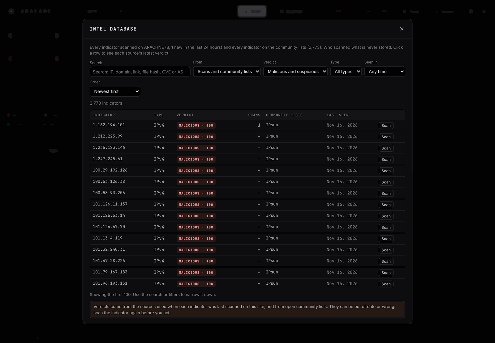<br><b>Intel DB:</b> every indicator scanned on the site and on the community lists</td>
</tr>
</table>

## Features (local app and website)

- **IOC scan report:** risk score and grade, a ring showing how many sources flag the IOC, a verdict table with one row per source and the full findings, filling in live as each lookup finishes.
- **Accounts found as platform cards:** username and email reports show every account found on another platform as a card with the platform's name and icon, its category and an open-profile link; account nodes in the graph show the same icon.
- **Every common indicator type:** IPv4/IPv6, domain, URL, email, username, file hash (MD5/SHA-1/SHA-256), ASN and CVE, plus threat actors, malware families and ATT&CK IDs. The type is detected for you and defanged values are refanged.
- **Overall risk score:** every IOC gets a 0 to 100 score and a grade (Critical, High, Medium, Low, Clean) combined from the per-source verdicts.
- **Bulk scans:** paste, upload or drop up to 500 IOCs and get one triage report sorted by risk, with a filter and one-click copy of the flagged IOCs.
- **Extract IOCs from text:** paste a phishing email (headers too), a threat report or logs and ARACHNE pulls out every indicator, defanged ones included. Private IPs and well-known sites start unticked.
- **Arachne Shield:** threat actor attribution with a confidence level per IOC, the scan mapped onto the MITRE ATT&CK matrix (with a Navigator layer download), the mitigations and log sources that matter most against it, a timeline, and actor profiles you can compare side by side.
- **Threat library:** profiles for ~1,100 threat actors, ~840 malware families and tools, and ATT&CK campaigns, techniques and mitigations, offline.
- **Pivot graph:** scan related indicators one at a time, all at once, or automatically to a set depth, then see everything as a web with malicious and suspicious nodes highlighted. A noise filter keeps CDNs and big providers out.
- **Detection rules:** turn a scan into Sigma, YARA, Suricata and Snort rules and Splunk (SPL), Microsoft Sentinel (KQL) and Elastic (KQL) queries.
- **Exports:** PDF and HTML reports, STIX 2.1 bundle, CSV of source verdicts, JSON, plain or defanged IOC lists, and a PNG of the graph.
- **History:** every scan is saved so you can reopen it and keep pivoting. Long scans keep running in the background, and **Stop all** ends them.
- **11 languages:** English, Spanish, German, French, Portuguese, Italian, Dutch, Polish, Japanese, Chinese and Korean.
- **Phone-friendly** layout with a bottom bar, and **keyboard shortcuts** for everything on desktop (press **?**).
- **Your keys stay yours:** API keys live on your machine (or, on the website, in your browser), never in the repo.

## Screenshots

<table>
<tr>
<td width="50%">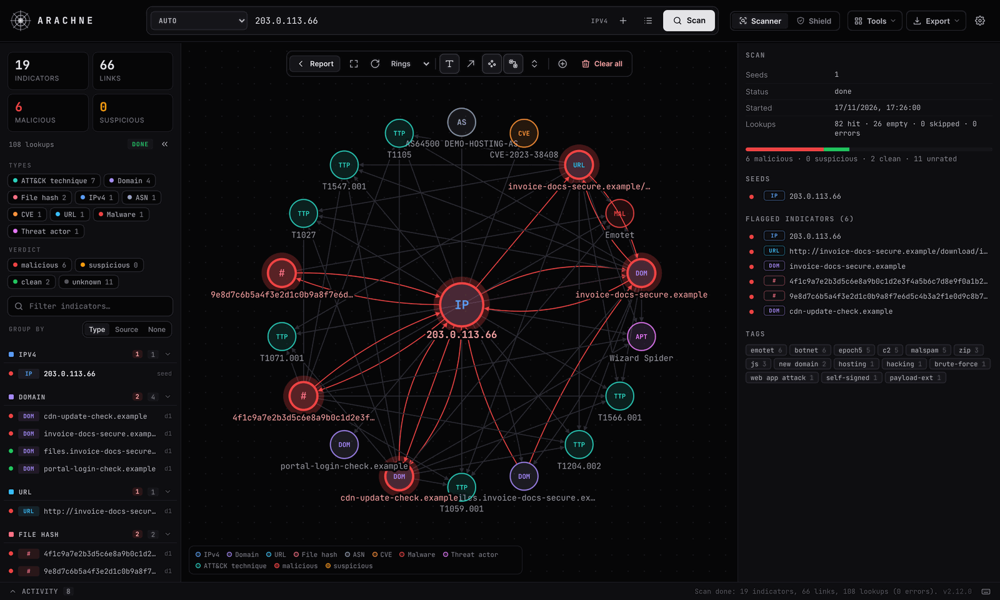<br><b>Graph:</b> everything connected to the scan</td>
<td width="50%">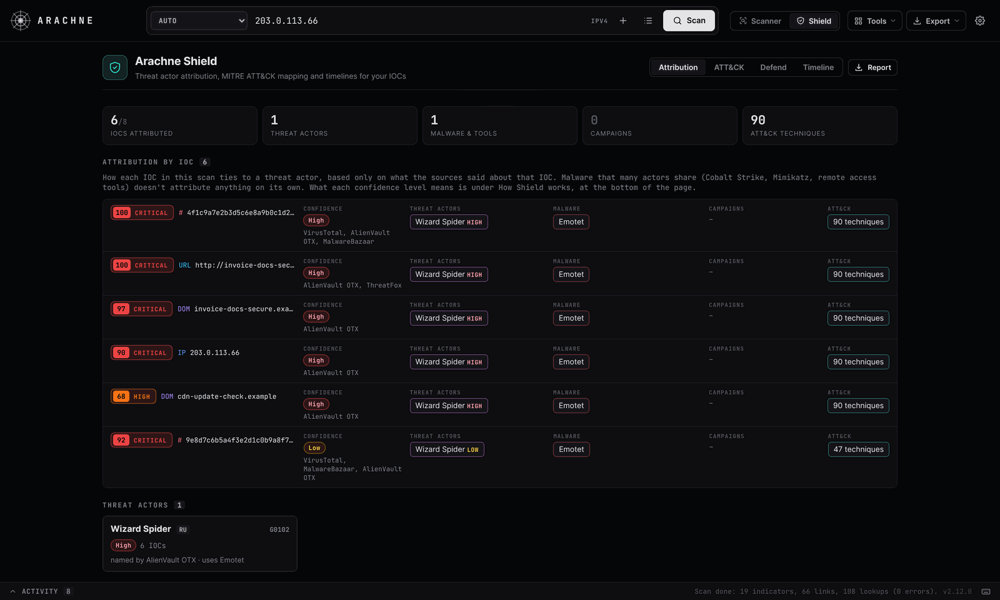<br><b>Shield:</b> who the IOCs point to, and how sure that is</td>
</tr>
<tr>
<td>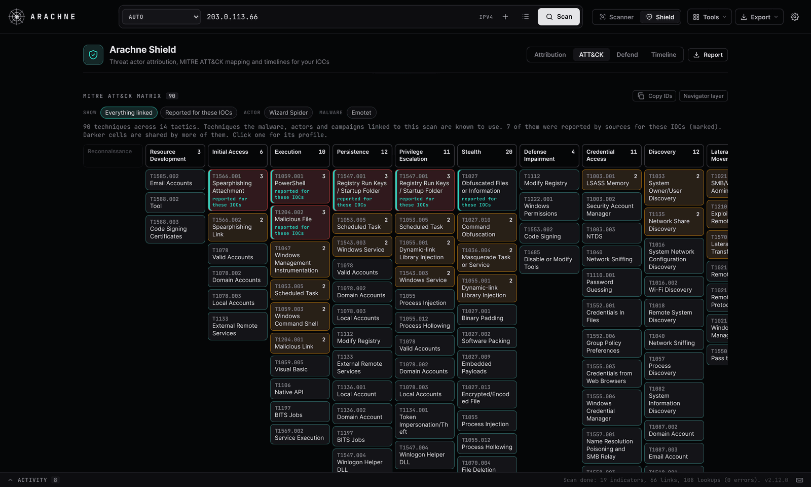<br><b>Shield:</b> the scan on the ATT&CK matrix</td>
<td>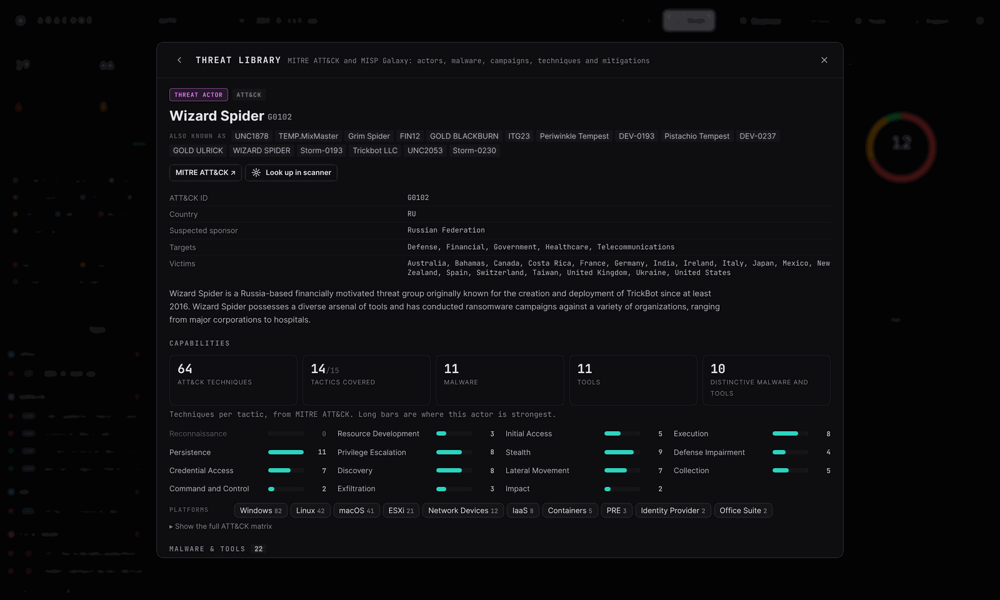<br><b>Threat library:</b> actor profiles and capabilities</td>
</tr>
<tr>
<td>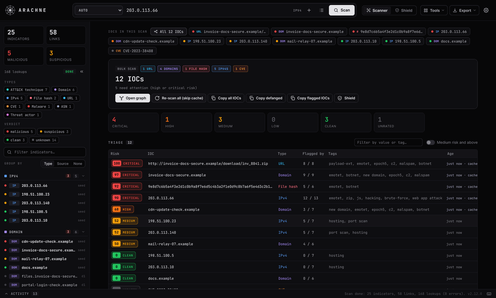<br><b>Bulk scan:</b> triage sorted by risk</td>
<td>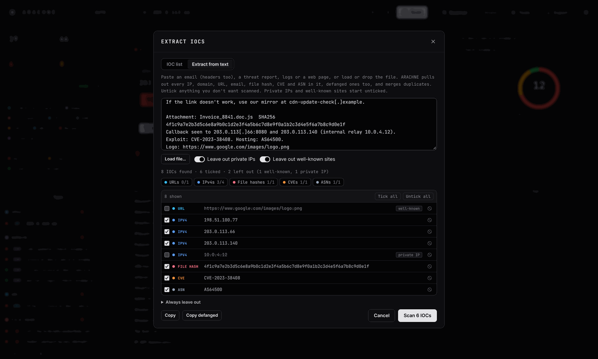<br><b>Extract from text:</b> IOCs out of an email or report</td>
</tr>
<tr>
<td>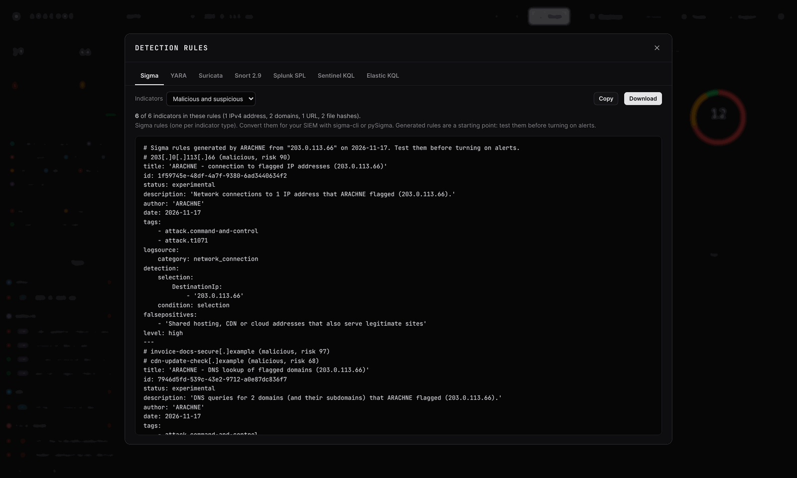<br><b>Detection rules:</b> Sigma, YARA, Suricata, Snort and SIEM queries</td>
<td align="center">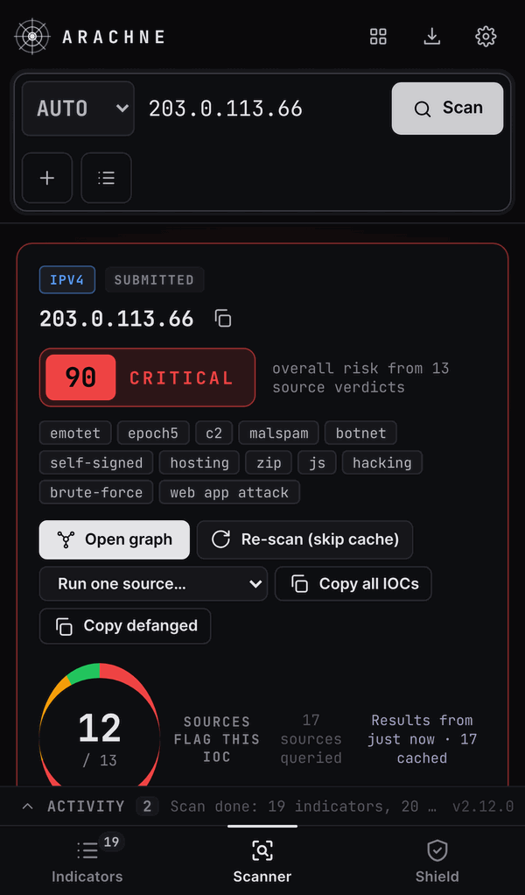<br><b>Phones:</b> the full app on a small screen</td>
</tr>
</table>

All screenshots use made-up demo data: documentation IP ranges and `.example` domains.

## Run it locally

```bash
git clone https://github.com/luke-mckeever/ARACHNE.git
cd ARACHNE
python server.py
```

It only needs Python 3.10 or newer. There's nothing to install. The UI opens at `http://127.0.0.1:8777`. On Windows you can double-click `start.bat` instead, and on Linux/macOS run `./start.sh`.

To shut it down, press Ctrl+C in its window, or double-click `stop.bat` (Windows) / run `./stop.sh` (Linux/macOS). The stop script finds the server through `data/arachne.pid`; if you started it on another port, pass the port: `stop.bat 9000` or `./stop.sh 9000`.

Optional flags: `--port 9000` and `--no-browser`.

### How it works

1. **Scan.** Paste one or more IOCs into the search bar and press **Scan**. For a longer list, use the **bulk scan** button next to it (or press **B**), or **X** to extract IOCs from text.
2. **Read the report.** Each enabled source is queried in parallel and the report fills in live. Sources that need an API key you haven't added are listed separately, so you can see what you're missing.
3. **Dig further.** The report lists every related indicator. Click **Scan** on any of them, or **Pivot: scan all**, then **Open graph** to see how everything connects. Switch to **Shield** for attribution and ATT&CK, or **Export** for reports and detection rules.

### API keys

Add your API keys under **Settings → API Keys**. A lot of sources work without one, but VirusTotal, AbuseIPDB and abuse.ch (MalwareBazaar, URLhaus and ThreatFox) are where most of the useful verdicts come from. Keys are saved to `data/settings.json`, which is git-ignored.

To move your keys to a new machine or a fresh clone, use **Export keys** to save them to `arachne-api-keys.json` and **Import keys** to load them back. Import only adds or updates keys; it never removes any. The export is plain text, so store it somewhere safe outside the repo folder (exported key files are git-ignored as a backstop).

## Sources

**No key needed:** MITRE ATT&CK and threat actors (built in, offline), DNS, RDAP/WHOIS, crt.sh, Wayback Machine, Mnemonic passive DNS, Shodan InternetDB, ip-api, SANS ISC, Tor exit list, AlienVault OTX, OpenPhish, CIRCL hashlookup, RIPEstat, NVD/CISA KEV, Gravatar, GitHub, Keybase, Hacker News, LeakCheck, and a username check across ~40 sites.

**Free key that adds more:** GreyNoise Community, urlscan.io, Pulsedive, IPinfo, OTX, NVD and GitHub work without a key but give more (or more requests) with one.

**API key:** VirusTotal, AbuseIPDB, MalwareBazaar / URLhaus / ThreatFox (one abuse.ch key), Shodan, IPQualityScore, SecurityTrails, Hunter.io, Have I Been Pwned, EmailRep, Google Safe Browsing, Hybrid Analysis.

Every module has a **Test** button in Settings, so you can check a key works before running a scan.

## Usage tips

- Click a row in the source verdict table to jump to that source's findings, or ↻ to re-run it. **Re-scan (skip cache)** runs every source again.
- Click any indicator in the left list to open its report. Press **V** to switch between the report and the graph, **I** for Shield, **T** for the threat library and **M** to fold the side panel away.
- In the graph, double-click a node to pivot on it. Right-click for more options, such as running a single module or opening the value in VirusTotal or Shodan.
- With auto-pivot, depth 1 is usually enough. Depth 2+ on a busy IP will hit the node limit quickly.
- The free VirusTotal tier is 4 requests a minute, so VT results come in slowly. That's expected.
- If the app feels sluggish, check **Tools → Scan history** for scans still running in the background and use **Stop all**.
- ThreatFox only flags exact matches: a URL on the same host, or the same IP on any port.

## Adding a module

Modules live in `osint/modules/`. A minimal one looks like this:

```python
@module("myfeed", "My Feed", types=["ipv4", "domain"], keys=["myfeed"], key_required=True,
        category="Threat Intel", desc="Checks my private feed.")
def myfeed(e, ctx, r):
    d = ctx.get_json(f"https://feed.example/api/{e.value}", headers={"X-Key": ctx.need("myfeed")})
    r.kv("Score", d["score"])
    r.score_verdict(d["score"], mal=80, sus=40)
    for host in d.get("related", []):
        r.add("domain", host, "related_to")   # listed as a related indicator in the report
```

It shows up in the UI automatically. To make its key editable in Settings, add the key to `API_KEYS` in `osint/settings.py`.

## Threat intel data

`static/intel/threat-kb.json` holds the threat actor, malware and ATT&CK data. It is built from open sources that allow commercial use, by `python tools/build_threat_kb.py` (run it after a new ATT&CK release and commit the result):

- **MITRE ATT&CK Enterprise** (techniques, groups, software, campaigns, mitigations, detection strategies and data components). © The MITRE Corporation. This work is reproduced and distributed with the permission of The MITRE Corporation, under MITRE's royalty-free [ATT&CK Terms of Use](https://attack.mitre.org/resources/legal-and-branding/terms-of-use/), which allow research, development and commercial use.
- **MISP Galaxy** threat-actor cluster (extra actors, country, suspected sponsor, targets, references) and the names and aliases from its malpedia cluster. CC0 1.0 / BSD 2-Clause.
- **Malpedia** itself (CC BY-NC-SA, non-commercial) and the **ETDA Threat Group Cards** (CC BY-NC-SA 4.0) are not copied, only linked.

## Translations

The interface text is translated in the browser by `static/js/i18n.js`, using one dictionary per language in `static/i18n/<code>.json` (English phrase → translation). Data from sources is never translated. To add or fix a phrase, edit the dictionaries; `{name}` placeholders and `<0>…</0>` tags must stay as they are. To find text that isn't translated yet, run `localStorage.setItem("arachne.i18n.debug","1")` in the browser console, reload, use the app, then run `I18N.missing()`. Run `python tools/check_i18n.py` before committing: it checks that every language has the same phrases and placeholders. Run `node tests/rules.test.mjs` to test the detection rules generator.

## Notes

- Everything is passive by default. The one module that connects to the target directly (HTTP Probe) only runs if you enable active modules in Settings.
- The local server binds to localhost and has no accounts or authentication, so don't expose it publicly. For a shared, signed-in version, use [arachne-app.site](https://arachne-app.site).
- Only use this for lawful purposes, and stick to each provider's terms of service.

## Versions

ARACHNE uses version numbers like `v2.12.1` (major.minor.patch). The current version is shown at the bottom right of the app, and [CHANGELOG.md](CHANGELOG.md) lists what changed in each release.

## License

MIT. `osint/cacert.pem` is Mozilla's CA bundle (MPL-2.0). Platform icons in `static/js/platform-icons.js` are from [Simple Icons](https://simpleicons.org) (CC0 1.0); the brands and logos belong to their owners.
